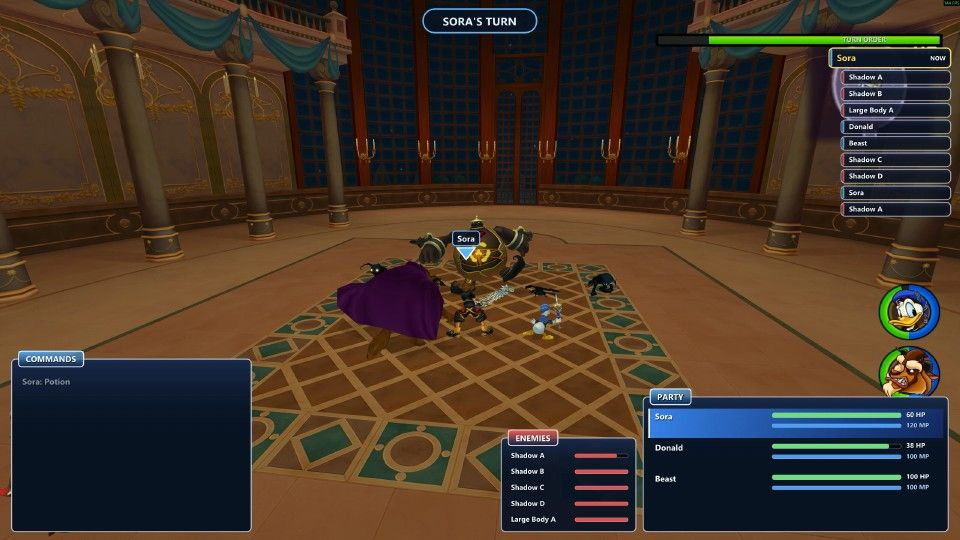
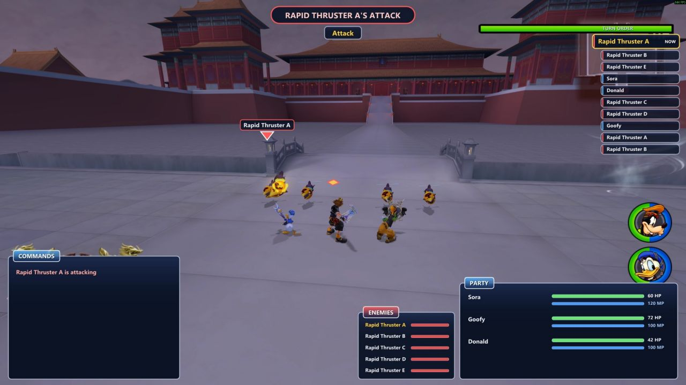
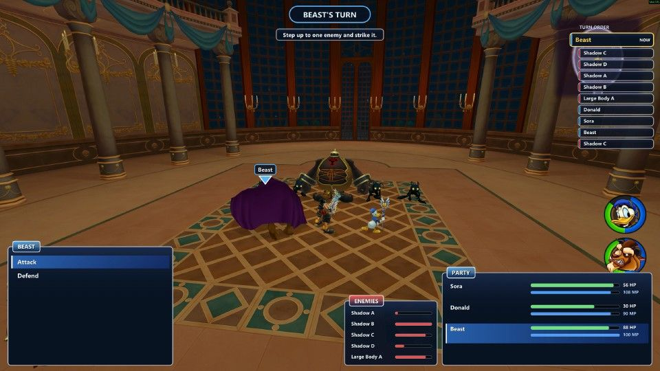

# Turn-Based Kingdom Hearts 2

**KINGDOM HEARTS II, fought like FINAL FANTASY X.** Random encounters, a visible turn order and one action per turn, played with KH2's own characters, Keyblade swings, spells and animations.

A mod for the Steam version of *KINGDOM HEARTS -HD 1.5+2.5 ReMIX-*. Everything you see and hear in a fight is KINGDOM HEARTS II's. Only the battle rules come from FINAL FANTASY X, and nothing from FFX is used or needed.



| | |
| --- | --- |
|  |  |

## What it plays like

- **Random encounters.** Enemies no longer roam the field. Walking fills a hidden encounter meter, and when it fills the screen shatters and a battle starts. Each part of a world has its own battle spot, so you fight where you are.
- **A CTB turn order, as in FFX.** The order of the next turns is listed on the right, and faster characters act more often. Only the one taking a turn moves; everyone else waits in their place.
- **Formation and camera.** Sora and his two partners line up facing the enemy line, and the camera sits behind the party. Whoever acts steps forward, makes a real KH2 move, then walks back.
- **Sora's commands:**
  - **Attack:** his real Keyblade strike.
  - **Magic:** the spells your save has (Fire, Blizzard, Thunder, Cure, Magnet, Reflect), cast with KH2's own spells and MP.
  - **Items:** only the items equipped on Sora, used through KH2's own menu, on one target or the whole party.
  - **Defend:** takes half damage, and the next turn comes sooner.
  - **Party:** swaps a partner through KH2's own Party command, for example Donald out and Auron in. It costs no turn.
  - **Escape:** runs from the fight.
- **Partners you control.** Donald, Goofy and each world's own partner (Beast, Auron and others) take their own turns, and you pick their actions.
  - Their actions are Attack, Magic or Techniques, Items and Defend.
  - **Donald:** Fire, Blizzard, Thunder and Cure.
  - **Goofy:** Goofy Bash, Goofy Tornado and Goofy Turbo.
  - Partners use only the items equipped on them.
- **Knock-outs.** A partner who falls stays down in KH2's own downed pose until a Cure or an item revives him. Partners get back up when the battle ends. If Sora falls, the battle is lost.
- **After the fight.** Win or escape and you're put back where you were walking.

### Items

| Item | Effect |
| --- | --- |
| Potion / Hi-Potion | Restores a third / two thirds of one character's HP |
| Ether | Restores a third of one character's MP |
| Elixir | Fully restores one character's HP and MP |
| Mega-Potion / Mega-Ether | Restores a third of the whole party's HP / MP |
| Megalixir | Fully restores the whole party's HP and MP |

## Controls (in battle)

| | Keyboard | Gamepad |
| --- | --- | --- |
| Choose | Arrow keys / WASD | D-pad / left stick |
| Confirm | Enter / Space / E | A |
| Back | Backspace / Q / Esc | B |

## Install

**With Melty (one click):** get it from [its Melty page](https://melty.gg/m/turn-based-kingdom-hearts-2).

**By hand:**
1. Copy `dinput8.dll` and `steam_appid.txt` from the release into the game's folder, next to `KINGDOM HEARTS II FINAL MIX.exe`.
2. Start KINGDOM HEARTS II and load a save.

To uninstall, delete `dinput8.dll` from the game folder.

**Needs:** *KINGDOM HEARTS -HD 1.5+2.5 ReMIX-* (Steam). Single player.

## How it works

`dinput8.dll` is a proxy: KH2 loads it at startup, and it passes every DirectInput call on to Windows' own `dinput8.dll`.
- **Where it runs:** only inside `KINGDOM HEARTS II FINAL MIX.exe`, and only after it has checked the game's code bytes. On any other build it stays off.
- **What it does:** it hooks the game with MinHook and drives KH2's own actors, commands and menus. It draws its windows with Dear ImGui (DirectX 11/12).
- **Its data:** the battle rules come from the JSON sheets in `sheets/`: commands, magic, items, partner moves, battle spots per room, and timings and camera settings.
- **Log:** `%LOCALAPPDATA%\KH2FFXTB\ffxtb.log` (the previous session is kept as `ffxtb.prev.log`). F10 shows a small debug line.

## Building

Requires Windows, Visual Studio 2022 (C++ x64 tools) and Python 3.

```bash
git clone --recursive https://github.com/saix93/Turn-Based-KH2.git
```

```bash
./pack.sh 1.6.47
```

`pack.sh` generates `src/gen/sheets.h` from `sheets/`, builds `dist/KH2xFFX-<version>/dinput8.dll` through `build.ps1`, and zips the release.

| Folder | What's in it |
| --- | --- |
| `src/` | The mod: battle state machine (`battle.cpp`), game access and hooks (`game.cpp`), UI (`ui.cpp`), Melty test mode (`testmode.cpp`) |
| `sheets/` | The battle data, as JSON |
| `tools/` | Research and sheet-generation scripts |
| `package/` | Files shipped with each release (readme, licenses) |
| `third_party/` | Dear ImGui and MinHook (git submodules) |

## Credits and license

- Mod code: MIT (see `package/LICENSE.txt`).
- [Dear ImGui](https://github.com/ocornut/imgui) by Omar Cornut (MIT) and [MinHook](https://github.com/TsudaKageyu/minhook) by Tsuda Kageyu (BSD-2-Clause). See `package/THIRD_PARTY_LICENSES.txt`.
- [OpenKH](https://github.com/OpenKH/OpenKh) documentation was used for KH2's object and file formats.
- KINGDOM HEARTS and FINAL FANTASY are © Disney and Square Enix. This is an unofficial fan mod. It ships none of the games' files, and you need your own copy of the game.
